# CCS Hub — Entity Relationship Diagram

## ERD (Mermaid)

```mermaid
erDiagram
    users {
        uuid id PK
        varchar email UK
        text password_hash
        user_role role
        varchar first_name
        varchar last_name
        varchar middle_name
        varchar student_number UK
        varchar employee_number UK
        varchar program
        varchar year_level
        varchar section
        text avatar_url
        boolean is_active
        boolean must_change_password
        timestamptz created_at
        timestamptz updated_at
    }

    refresh_tokens {
        uuid id PK
        uuid user_id FK
        text token_hash UK
        timestamptz expires_at
        boolean revoked
        timestamptz created_at
    }

    password_reset_tokens {
        uuid id PK
        uuid user_id FK
        text token_hash
        timestamptz expires_at
        boolean used
        timestamptz created_at
    }

    courses {
        uuid id PK
        varchar code UK
        varchar title
        int units
        text description
        varchar program
        varchar year_level
        timestamptz created_at
        timestamptz updated_at
    }

    faculty_course_assignments {
        uuid id PK
        uuid faculty_id FK
        uuid course_id FK
        varchar academic_year
        int semester
        varchar section
        timestamptz created_at
    }

    enrollments {
        uuid id PK
        uuid student_id FK
        uuid course_id FK
        varchar academic_year
        int semester
        timestamptz created_at
    }

    class_schedules {
        uuid id PK
        uuid course_id FK
        uuid faculty_id FK
        varchar section
        day_of_week day
        time start_time
        time end_time
        varchar room
        varchar academic_year
        int semester
        timestamptz created_at
        timestamptz updated_at
    }

    consultation_slots {
        uuid id PK
        uuid faculty_id FK
        day_of_week day
        time start_time
        time end_time
        boolean is_active
        timestamptz created_at
        timestamptz updated_at
    }

    consultation_requests {
        uuid id PK
        uuid student_id FK
        uuid faculty_id FK
        uuid slot_id FK
        date requested_date
        time start_time
        time end_time
        text subject
        text message
        consultation_status status
        text faculty_note
        timestamptz created_at
        timestamptz updated_at
    }

    events {
        uuid id PK
        varchar title
        text description
        event_category category
        varchar location
        timestamptz starts_at
        timestamptz ends_at
        timestamptz registration_deadline
        int max_slots
        boolean is_published
        uuid created_by FK
        timestamptz created_at
        timestamptz updated_at
    }

    event_registrations {
        uuid id PK
        uuid event_id FK
        uuid user_id FK
        text qr_payload
        attendance_status attendance_status
        timestamptz attended_at
        timestamptz created_at
        timestamptz updated_at
    }

    organizations {
        uuid id PK
        varchar name UK
        varchar acronym
        text description
        text logo_url
        uuid adviser_id FK
        boolean is_active
        timestamptz created_at
        timestamptz updated_at
    }

    org_memberships {
        uuid id PK
        uuid organization_id FK
        uuid user_id FK
        membership_status status
        membership_role role
        text application_note
        uuid reviewed_by FK
        text review_note
        timestamptz reviewed_at
        timestamptz created_at
        timestamptz updated_at
    }

    announcements {
        uuid id PK
        varchar title
        text body
        announcement_audience audience
        uuid organization_id FK
        boolean is_pinned
        timestamptz published_at
        timestamptz expires_at
        uuid created_by FK
        timestamptz created_at
        timestamptz updated_at
    }

    grades {
        uuid id PK
        uuid student_id FK
        uuid course_id FK
        varchar academic_year
        int semester
        grade_period period
        numeric grade
        timestamptz created_at
        timestamptz updated_at
    }

    evaluation_periods {
        uuid id PK
        varchar academic_year
        int semester
        varchar label
        timestamptz opens_at
        timestamptz closes_at
        timestamptz created_at
    }

    evaluation_submissions {
        uuid id PK
        uuid period_id FK
        uuid student_id FK
        uuid faculty_id FK
        uuid course_id FK
        text ratings
        text comments
        timestamptz submitted_at
        timestamptz created_at
    }

    research_studies {
        uuid id PK
        varchar title
        text authors
        text abstract
        text keywords
        varchar program
        varchar academic_year
        text search_vector
        uuid uploaded_by FK
        timestamptz created_at
        timestamptz updated_at
    }

    campus_rooms {
        uuid id PK
        varchar code UK
        varchar name
        building building
        int floor
        text description
        int capacity
        numeric map_x
        numeric map_y
        boolean is_active
        timestamptz created_at
        timestamptz updated_at
    }

    users ||--o{ refresh_tokens : "has"
    users ||--o{ password_reset_tokens : "has"
    users ||--o{ faculty_course_assignments : "teaches"
    users ||--o{ enrollments : "enrolled in"
    users ||--o{ class_schedules : "handles"
    users ||--o{ consultation_slots : "offers"
    users ||--o{ consultation_requests : "requests as student"
    users ||--o{ consultation_requests : "receives as faculty"
    users ||--o{ event_registrations : "registers for"
    users ||--o{ events : "creates"
    users ||--o{ organizations : "advises"
    users ||--o{ org_memberships : "member of"
    users ||--o{ org_memberships : "reviews"
    users ||--o{ announcements : "creates"
    users ||--o{ grades : "has"
    users ||--o{ evaluation_submissions : "submits as student"
    users ||--o{ evaluation_submissions : "evaluated as faculty"
    users ||--o{ research_studies : "uploads"

    courses ||--o{ faculty_course_assignments : "assigned to"
    courses ||--o{ enrollments : "has"
    courses ||--o{ class_schedules : "scheduled as"
    courses ||--o{ grades : "graded in"
    courses ||--o{ evaluation_submissions : "evaluated in"

    consultation_slots ||--o{ consultation_requests : "booked as"
    events ||--o{ event_registrations : "has"
    organizations ||--o{ org_memberships : "has"
    organizations ||--o{ announcements : "publishes"
    evaluation_periods ||--o{ evaluation_submissions : "contains"
```

## Key Enums

| Enum | Values |
|---|---|
| `user_role` | `student`, `faculty`, `org_officer`, `admin` |
| `day_of_week` | `monday`, `tuesday`, `wednesday`, `thursday`, `friday`, `saturday` |
| `consultation_status` | `pending`, `approved`, `declined`, `cancelled` |
| `event_category` | `academic`, `cultural`, `sports`, `seminar`, `org`, `other` |
| `attendance_status` | `registered`, `attended`, `absent` |
| `membership_status` | `pending`, `active`, `declined`, `removed` |
| `membership_role` | `member`, `officer`, `president` |
| `announcement_audience` | `all`, `dean`, `ccs`, `org` |
| `grade_period` | `Prelims`, `Midterms`, `Finals` |
| `building` | `main`, `annex`, `gymnasium`, `library`, `admin` |

## Notes

- **Double-booking prevention**: `consultation_requests` has a `btree_gist` EXCLUDE constraint on `(faculty_id, requested_date, tsrange(start, end))` filtered to non-cancelled/declined rows.
- **Full-text search**: `research_studies.search_vector` is a `tsvector` maintained by a trigger; a GIN index enables fast search.
- **Grades**: Stored as `numeric(4,2)` using the Philippine scale — 1.00 (highest/Excellent) to 5.00 (Failing). INC = Incomplete is tracked separately in application logic.
- **QR attendance**: `event_registrations.qr_payload` stores a signed JWT for in-venue scanning.
